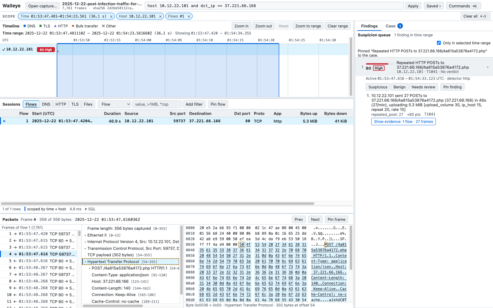

# Walleye

Walleye is a desktop app for security analysts that analyzes packet captures (PCAPs) on your own machine. It makes no network calls. Open a capture and Walleye indexes it once. From then on, every view loads in well under a second, even on a 10 GB capture. Five views share the same filter and time range:

- **Timeline:** activity per host over time. Drag across it to narrow every other view.
- **Session table:** flows, DNS, HTTP, TLS and file transfers, with a filter language.
- **Packet pane:** the decoded fields and hex for each frame, with each field highlighted in the hex.
- **Suspicion queue:** hosts ranked by score. Each entry lists its reasons, their weights and the frames behind them.
- **Case panel:** verdicts, pins and notes. Exports indicators (CSV/JSON) and a report (Markdown/PDF).

A scope bar under the header shows, as removable chips, everything that is narrowing the views: the time range, selected hosts and flows, and the focused Wi-Fi device. **Clear all** (⌘⇧X / Ctrl+Shift+X) resets them and keeps the filter.

Every finding, indicator and report line cites frame numbers and the capture's SHA-256, so any claim can be checked against the raw packets.

**Wi-Fi (802.11) captures** from monitor-mode tools such as the WiFi Coconut, airodump-ng or Kismet (link types 105 and 127) open too. Walleye adds Access points, Clients and Wi-Fi frames tabs, a timeline with one lane per transmitting device, and detections for deauthentication floods, evil twins and karma access points. A deauth flood is judged partly by signal strength: frames that arrive at the same strength as the access point's own beacons most likely came from the real access point. Filter with `wifi.*`, `ap.*` and `client.*` fields or `mac aa:bb:cc:dd:ee:ff`. Unencrypted Wi-Fi traffic (open networks, Apple AWDL) also feeds the normal connection views.



## Status

The MVP and Wi-Fi support are both on `main`, and every gate below passes.

**MVP gates**

| Gate | Target | Measured |
|---|---|---|
| Index a 10 GB capture | < 2 min | 43.3 s (248 MB/s, peak 1.75 GiB RAM, index 0.53 % of raw) |
| Queries and timeline brushing, 95th percentile | < 1 s | 27 ms worst query, 67 ms worst brush |
| C2 host in the top 5 | 3 labelled samples | ranked first on 7 of 7, including real NetSupport RAT and StealC captures |
| False positives in the top 10, benign capture | ≤ 30 % | 0 % |
| Fuzzing, 10 min per target | no crashes | 15 of 15 targets clean |
| Network calls at runtime | none | none, verified under a sandbox that denies all network access |

**Wi-Fi gates**

| Check | Measured |
|---|---|
| Real WiFi Coconut capture (1.2 M frames) | opened in 3.8 s (about 1,150 MB/s), every view under 15 ms, frame counts match Wireshark, 0 findings (the capture has no attacks) |
| Detection eval, including generated deauth, evil-twin and karma attacks | attacker ranked first on 7 of 7; 0 % false positives on the benign captures |
| Fuzzing the 802.11 parsers, 10 min per target | no crashes (5.3 M and 1.7 M inputs) |
| Security review and code review | all findings fixed, with tests |

More on these and on the known gaps:

- [`docs/MVP_REPORT.md`](docs/MVP_REPORT.md): the full MVP gate table, the known gaps and the v1 backlog.
- [`docs/CONTRACTS.md`](docs/CONTRACTS.md) §11: how 802.11 is decoded and indexed. Wi-Fi known gaps are listed in [PR #3](https://github.com/JWhiteUX/walleye/pull/3).
- [`docs/BUILD_LOG.md`](docs/BUILD_LOG.md): the commands that produced each number, with their output.

## How it works

| Part | Path | What it does |
|---|---|---|
| Ingest | `crates/walleye-ingest` | Reads pcap/pcapng and reassembles TCP. Decodes DNS, HTTP/1.x, TLS (JA4/JA4S), X.509, and 802.11 with radiotap. |
| Index | `crates/walleye-index` | Writes the index as zstd-compressed Parquet and queries it with DuckDB. The filter language compiles to parameterized SQL only. |
| Detect | `crates/walleye-detect`, `rules/` | YAML rules for beaconing, DNS tunneling, DGA domains, cleartext HTTP on TLS ports, repeated-POST exfiltration, and Wi-Fi deauth floods, evil twins and karma access points. |
| Case | `crates/walleye-case` | Verdicts, pins, notes, IOC export and reports. |
| Engine | `crates/walleye-engine` | Connects the parts above behind one `Backend` trait. |
| App | `app/src-tauri`, `app/src` | Tauri 2 desktop shell, with a React + TypeScript + Vite UI. |
| Tools | `tools/` | Synthetic capture generator, query benchmark, detection eval and a dev-only test bridge. |
| Fuzz | `fuzz/` | 15 cargo-fuzz targets and the network-deny harness. |

Interfaces between the parts are in [`docs/CONTRACTS.md`](docs/CONTRACTS.md). The reasons behind design choices, including the Tauri-specific ones, are in [`docs/DECISIONS.md`](docs/DECISIONS.md).

## Getting started

### 1. Install the toolchain

| Tool | Install |
|---|---|
| Rust stable | `curl --proto '=https' --tlsv1.2 -sSf https://sh.rustup.rs \| sh` |
| Node 22+ | from [nodejs.org](https://nodejs.org/) or `brew install node@22` |
| pnpm 11 | `corepack enable` (the repo pins `pnpm@11.10.0`) |
| **macOS:** Xcode command-line tools | `xcode-select --install` |
| **Linux:** system libraries | see the [Tauri prerequisites](https://tauri.app/start/prerequisites/) |

### 2. Clone and run

```sh
git clone https://github.com/JWhiteUX/walleye.git
cd walleye
pnpm install
pnpm tauri dev        # run the app (UI hot-reloads)
```

The first build compiles DuckDB from source. It takes several minutes and uses a few GB in `target/`.

To work on the UI alone, `pnpm dev` runs it in a browser against a built-in mock capture (add `?mock=wifi` to the URL for a Wi-Fi one). If you're new to Tauri, [`docs/DEV_SETUP.md`](docs/DEV_SETUP.md) explains how the UI and Rust sides talk to each other and where configuration lives.

### 3. Build and install the app

```sh
pnpm tauri build
```

The packages land in `target/release/bundle/`: `macos/Walleye.app` and `dmg/` on macOS, `deb/` and `appimage/` on Linux. On macOS, drag `Walleye.app` into Applications.

The build isn't signed or notarized, so on first launch macOS says it can't verify the developer. Right-click the app, choose **Open**, then confirm. Or allow it under **System Settings → Privacy & Security**. You only need to do this once.

## Testing

```sh
scripts/check.sh      # fmt, clippy -D warnings, cargo test, lint, Vitest (must pass before any commit)
pnpm e2e              # Playwright against the mock backend
scripts/netdeny.sh    # macOS: runs the engine with all network access denied
```

To get test captures, generate them with `walleye-gen` (for example `--scenario beacon`). [`fixtures/README.md`](fixtures/README.md) has the exact commands, plus the labelled real-world samples used for detection eval.

## Rules for contributors

- **Treat every capture as hostile input.** Never execute, open or import anything carved from one.
- **No network calls at runtime** unless a user turns a feature on.
- **Never commit captures.** They live in `$WALLEYE_FIXTURES` (default `~/.walleye-fixtures`).

## License

[MIT](LICENSE)
